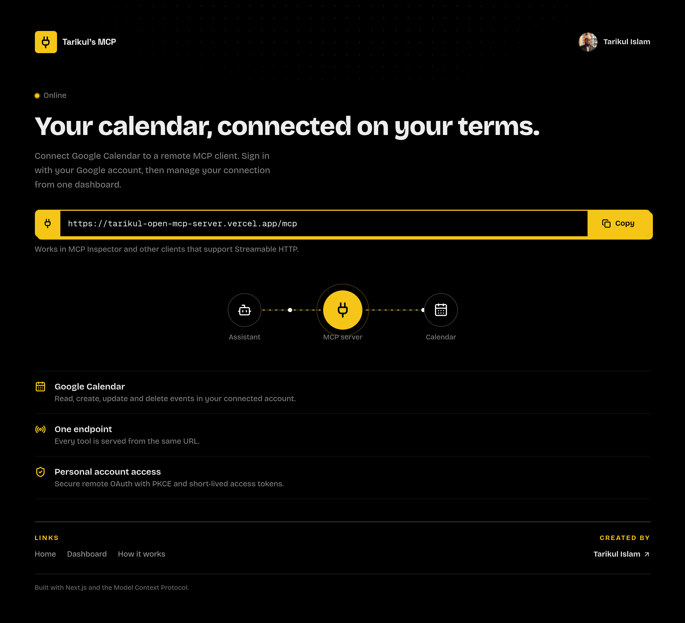
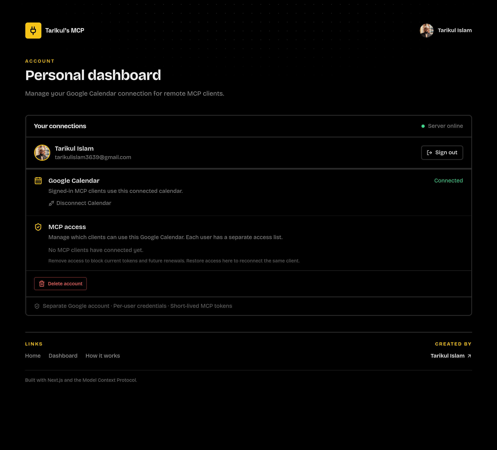
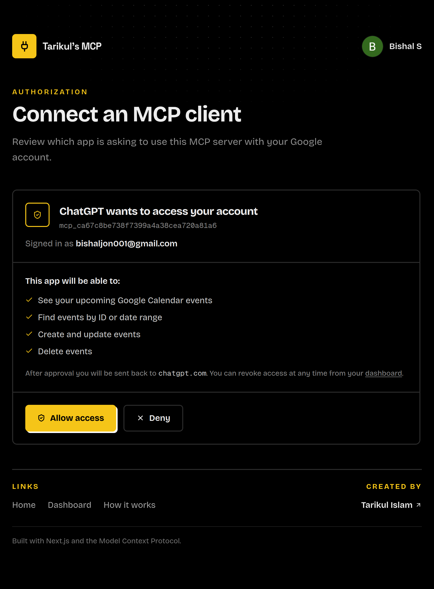

# Tarikul Open MCP Server

A remote [Model Context Protocol (MCP)](https://modelcontextprotocol.io/) server that lets compatible AI clients work with a user's Google Calendar. The project has two independently deployable applications: a NestJS API and a Next.js web app for sign-in, consent, account management, and documentation.

## Screenshots

<details>
<summary>Home page</summary>


</details>

<details>
<summary>Account dashboard</summary>


</details>

<details>
<summary>MCP client authorization</summary>


</details>

## Features

- Streamable HTTP MCP endpoint at `/mcp`.
- OAuth 2.0 authorization code flow with PKCE, dynamic client registration, and per-user client consent.
- Separate Google sign-in and Google Calendar authorization.
- Calendar tools for listing, searching, creating, updating, and deleting events in the connected user's primary calendar.
- Dashboard for Calendar connection status and MCP client access management.
- OAuth discovery metadata, health endpoint, and Swagger API docs.

## Project layout

| Directory | Application | Documentation |
| --- | --- | --- |
| [`server/`](server/README.md) | NestJS API, PostgreSQL, Prisma, Google OAuth, and MCP tools | [Server README](server/README.md) |
| [`web/`](web/README.md) | Next.js home page, dashboard, consent page, and docs | [Web README](web/README.md) |
| [`docs/`](docs/mcp-client-auth-flow.md) | MCP client OAuth and request authentication flow | [MCP client auth flow](docs/mcp-client-auth-flow.md) |
| `screenshots/` | Screenshots shown above | |

Each app has its own `package.json`, dependencies, and lockfile. Install and run them from their own directories.

## Local development

### Requirements

- Node.js 24
- pnpm 12
- PostgreSQL
- A Google OAuth client with the two callback URLs listed below

### Start the API

```bash
cd server
pnpm install
cp .env.example .env
```

Set `DATABASE_URL`, `GOOGLE_CLIENT_ID`, `GOOGLE_CLIENT_SECRET`, and a random `MCP_AUTH_SECRET` of at least 32 characters in `server/.env`. Create the database, then apply migrations and start the API:

```bash
pnpm prisma:generate
pnpm prisma:migrate
pnpm start:dev
```

The API defaults to `http://localhost:5000`.

### Start the web app

In a second terminal:

```bash
cd web
pnpm install
cp .env.example .env.local
pnpm dev
```

The web app defaults to `http://localhost:3000`. `NEXT_PUBLIC_BACKEND_URL` in `web/.env.local` should point to the API, normally `http://localhost:5000`.

### Google OAuth callback URLs

Add both callback URLs to the Google OAuth client:

```text
http://localhost:5000/api/auth/callback
http://localhost:5000/api/auth/calendar/callback
```

The first handles Google sign-in. The second handles Google Calendar authorization. For a deployment with separate web and API domains, use the frontend's proxied callback URLs (`https://<web-domain>/api/auth/callback` and `https://<web-domain>/api/auth/calendar/callback`) in both the API configuration and Google Cloud Console. Set `WEB_ORIGIN` to the web app origin and `NEXT_PUBLIC_BACKEND_URL` to the API origin.

## MCP endpoint and API docs

- MCP endpoint: `http://localhost:5000/mcp`
- OAuth authorization server metadata: `http://localhost:5000/.well-known/oauth-authorization-server`
- Protected resource metadata: `http://localhost:5000/.well-known/oauth-protected-resource/mcp`
- Health: `http://localhost:5000/api/health`
- Swagger UI: `http://localhost:5000/api/docs`

For environment variables, OAuth details, and the full tool list, see the [server README](server/README.md). For frontend routes and proxy configuration, see the [web README](web/README.md).

## Author

**Tarikul Islam** — [tarikul-islam.me](https://tarikul-islam.me/)
