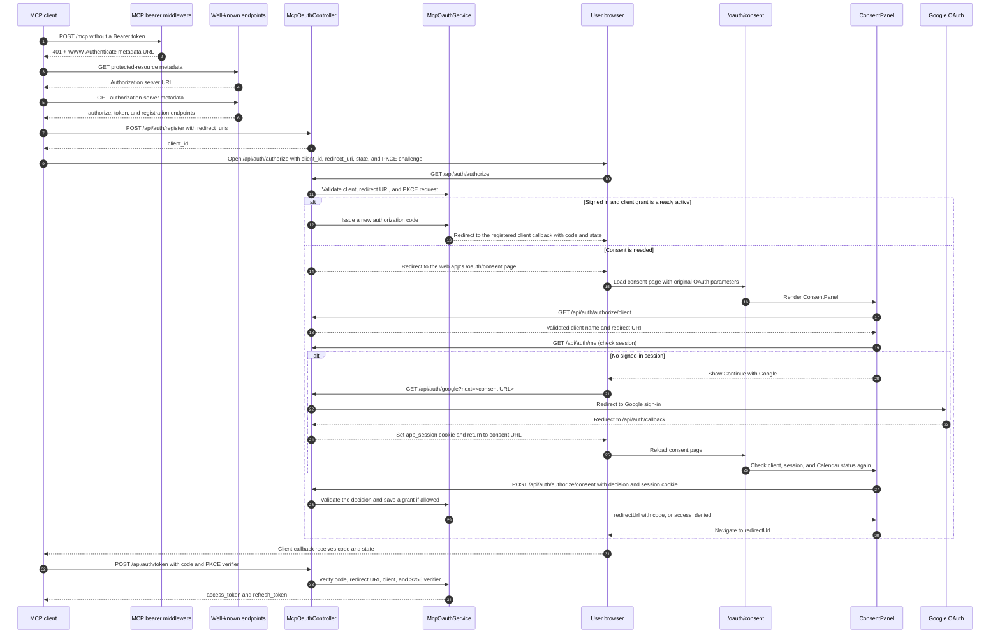
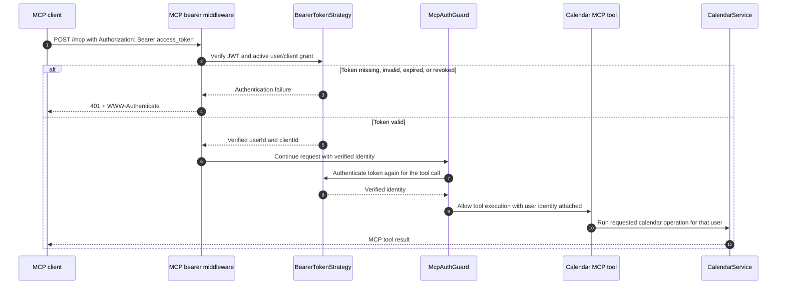

# MCP Client Authentication Flow

This document traces how a remote MCP client discovers OAuth, receives the user's consent, exchanges an authorization code for tokens, and calls the protected MCP endpoint.

## Components at a glance

| Component | Responsibility |
| --- | --- |
| MCP client | Discovers OAuth, registers itself, opens the browser for authorization, stores tokens, and calls `/mcp`. |
| `createMcpBearerAuthMiddleware` | Rejects unauthenticated HTTP requests to `/mcp` with `401` and the protected-resource metadata URL. |
| `WellKnownController` / `WellKnownService` | Publish protected-resource and authorization-server metadata. |
| `McpOauthController` | Handles client registration, authorization, consent submission, and token requests. |
| `McpOauthService` | Validates client redirects and PKCE, stores per-user grants and authorization codes, and issues or rotates tokens. |
| Consent page / `ConsentPanel` | Shows the requesting client, checks the user's session, and submits Allow or Deny. |
| `OAuthController` | Signs the user in with Google and returns them to the consent page. |
| `BearerTokenStrategy` / `McpAuthGuard` | Validate the access token and confirm that the user has not revoked the client grant. |

## Authorization and token exchange

The client registration request is Dynamic Client Registration. The authorization code is short-lived and can be exchanged once. The PKCE verifier must match the S256 challenge supplied in the authorization request.

If the user denies access, the browser is returned to the registered callback with `error=access_denied` and the original `state`. If the user is already signed in and has an active grant for that client, the server skips the consent page and redirects directly with a new authorization code.

## Authenticated MCP requests

Access tokens expire after 15 minutes. The client can exchange its rotating refresh token at `/api/auth/token` to receive a new access token and refresh token. Revoking the MCP client grant in the dashboard makes both existing access tokens and refresh attempts fail on the next request. Calendar access is separate: the user must connect Google Calendar from the dashboard before calendar tools can access it.

## Request and page map

| Flow step | Endpoint or UI | Implementation |
| --- | --- | --- |
| MCP request challenge | `POST /mcp` | [`main.ts`](../server/src/main.ts), [`mcp-bearer-auth.middleware.ts`](../server/src/modules/auth/middleware/mcp-bearer-auth.middleware.ts) |
| OAuth discovery | `GET /.well-known/oauth-protected-resource/mcp`, `GET /.well-known/oauth-authorization-server` | [`well-known.controller.ts`](../server/src/modules/well-known/controllers/well-known.controller.ts), [`well-known.service.ts`](../server/src/modules/well-known/services/well-known.service.ts) |
| Dynamic client registration | `POST /api/auth/register` | [`mcp-oauth.controller.ts`](../server/src/modules/auth/controllers/mcp-oauth.controller.ts), [`client-registration.service.ts`](../server/src/modules/auth/services/client-registration.service.ts) |
| Authorize / redirect to consent | `GET /api/auth/authorize` | [`mcp-oauth.controller.ts`](../server/src/modules/auth/controllers/mcp-oauth.controller.ts), [`mcp-oauth.service.ts`](../server/src/modules/auth/services/mcp-oauth.service.ts) |
| Consent page | `/oauth/consent` | [`page.tsx`](../web/app/oauth/consent/page.tsx), [`consent-panel.tsx`](../web/components/oauth/consent-panel.tsx) |
| Client details shown on consent page | `GET /api/auth/authorize/client` | [`mcp-oauth.controller.ts`](../server/src/modules/auth/controllers/mcp-oauth.controller.ts) |
| Current user and Calendar connection status | `GET /api/auth/me`, `GET /api/auth/calendar/status` | [`auth.controller.ts`](../server/src/modules/auth/controllers/auth.controller.ts), [`calendar.controller.ts`](../server/src/modules/auth/controllers/calendar.controller.ts) |
| Google sign-in and return | `GET /api/auth/google`, `GET /api/auth/callback` | [`oauth.controller.ts`](../server/src/modules/auth/controllers/oauth.controller.ts) |
| Save Allow / Deny decision | `POST /api/auth/authorize/consent` | [`mcp-oauth.controller.ts`](../server/src/modules/auth/controllers/mcp-oauth.controller.ts), [`session.guard.ts`](../server/src/modules/auth/guards/session.guard.ts), [`mcp-oauth.service.ts`](../server/src/modules/auth/services/mcp-oauth.service.ts) |
| Code exchange / refresh | `POST /api/auth/token` | [`mcp-oauth.controller.ts`](../server/src/modules/auth/controllers/mcp-oauth.controller.ts), [`mcp-oauth.service.ts`](../server/src/modules/auth/services/mcp-oauth.service.ts), [`access-token.service.ts`](../server/src/modules/auth/services/access-token.service.ts) |
| Validate MCP request and execute tool | `POST /mcp` | [`bearer-token.strategy.ts`](../server/src/modules/auth/strategies/bearer-token.strategy.ts), [`mcp-auth.guard.ts`](../server/src/modules/auth/guards/mcp-auth.guard.ts), [`calendar.tools.ts`](../server/src/tools/calendar/calendar.tools.ts), [`calendar.service.ts`](../server/src/tools/calendar/calendar.service.ts) |
| Revoke or restore a client grant | Dashboard MCP access controls | [`client-access.controller.ts`](../server/src/modules/auth/controllers/client-access.controller.ts), [`client-access.service.ts`](../server/src/modules/auth/services/client-access.service.ts), [`owner-dashboard-client-management.tsx`](../web/components/dashboard/owner-dashboard-client-management.tsx) |

The web app proxies `/api/*` and `/.well-known/*` requests to the backend through [`next.config.ts`](../web/next.config.ts). The authorization endpoint redirects the browser to the frontend consent page; consent submissions and Google login endpoints are still handled by the backend.
